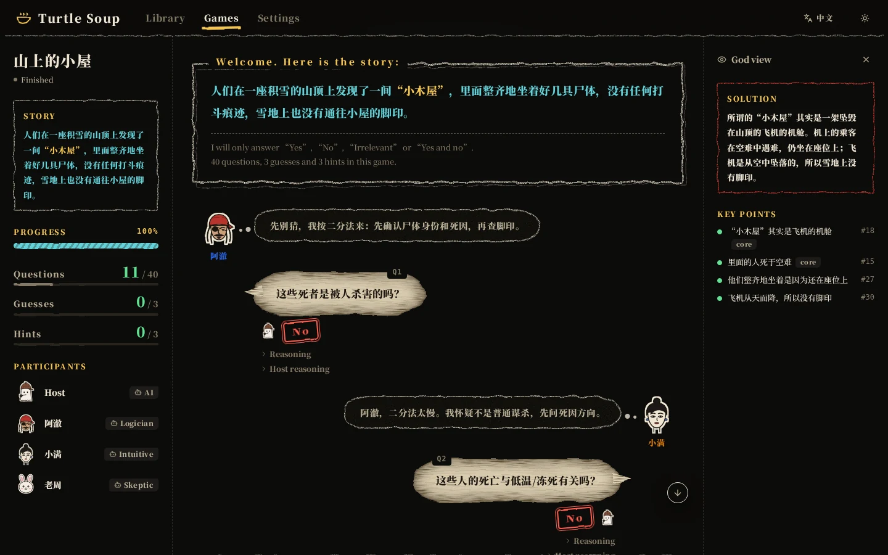
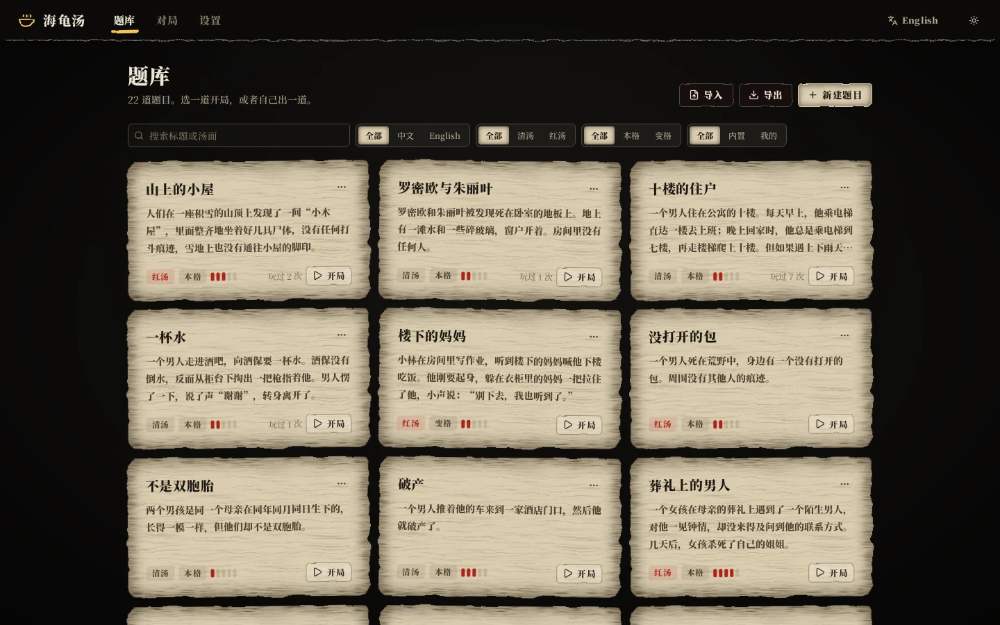
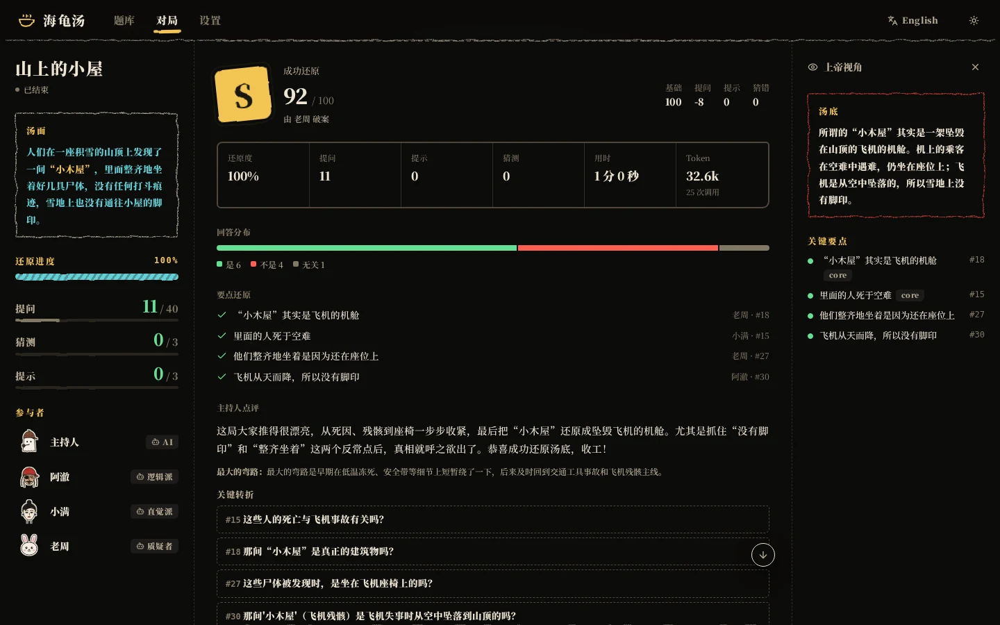
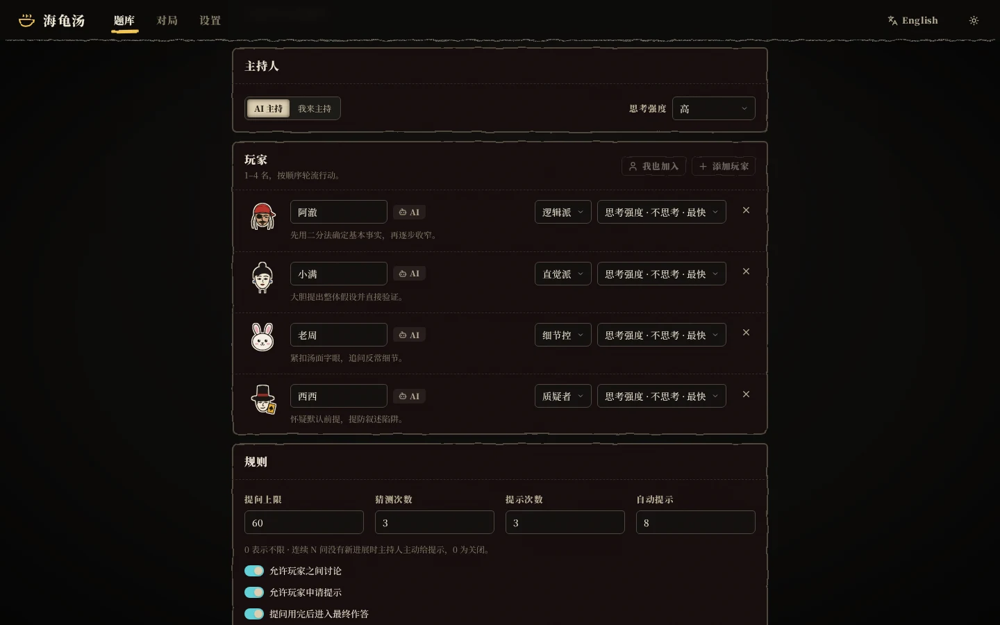
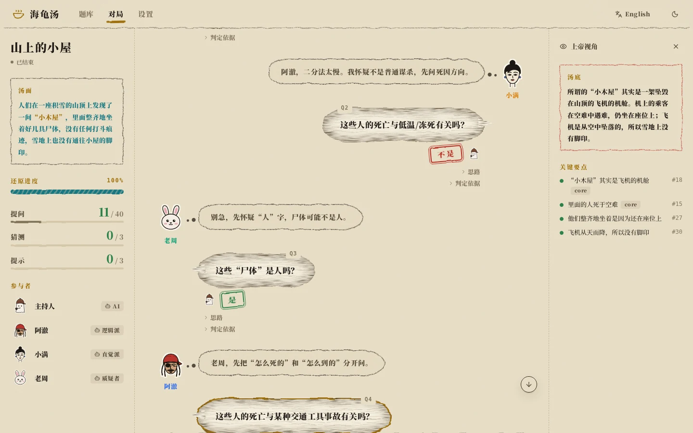

<div align="center">

# Turtle Soup · 海龟汤

**Humans write the puzzles. An AI host knows the truth. AI players ask yes/no questions until they crack it.** A complete "turtle soup" (situation puzzle / lateral-thinking) game. Watch, step in at any time, or join as a player or as the host yourself.

[中文](README.md) · Powered by DeepSeek V4.1 Flash · FastAPI + React

[](https://github.com/JQW2006/turtle-soup/actions/workflows/ci.yml)
[](LICENSE)


</div>



> A hand-drawn, noir picture-book look: every player gets a sketched character portrait, questions sit in parchment speech bubbles, the host stamps its verdicts, and the story is framed in chalk.

## Features

**Authoring**
- Story, solution, host notes, tone (clear / dark), genre (realistic / supernatural), difficulty, tags
- **AI key-point extraction** splits the solution into 3–6 yes/no-verifiable facts (core vs. minor, weighted). They drive progress tracking and judging, and you can edit them.
- **AI quality check** flags leaks, missing clues, contradictions, multiple solutions, obscure knowledge and ambiguous wording, and suggests difficulty and tags.
- 22 built-in classics (14 Chinese, 8 English), JSON import/export, and solutions hidden by default to avoid spoilers

**Playing**
- 1–4 players take turns. Each AI player has its own reasoning style (logician, intuitive, detail hunter, skeptic, or custom) and thinking level.
- The host answers only **Yes / No / Irrelevant / Yes and no**. Open questions get "please rephrase" and don't count.
- The host marks **key questions** and may add a spoiler-free note (getting close / premise is off / already asked / not important).
- Players can **chat** with each other without spending questions.
- Players submit full **solutions**. The host judges each one against the key points and gives feedback without spoilers.
- **Hints** come when players ask for them, or automatically after N questions without progress, and get more specific over time.
- Question, guess and hint limits are configurable, with a **final answer** round once questions run out.
- Live progress, counters and "who is thinking". Each message can be expanded to show the AI's reasoning.

**Where the human fits**
- **Spectator:** pause, resume, step (Space / `S`), three speeds, inject hints (yours or AI-written), **correct a wrong verdict**, reveal the solution.
- **God view:** see the solution, which key points have been found, and the host's reasoning.
- **Player:** ask, solve, request a hint or pass on your turn, and chat with your AI teammates any time.
- **Host:** answer questions, judge solutions and give hints yourself, with an "Ask AI" button for a reference verdict.

**Review**
- Rating (S–D) with a score breakdown, which player found each point and on which question, answer distribution, duration and token usage
- Host commentary: summary, turning-point questions (click to jump), biggest detour, MVP
- Markdown / JSON export and one-click "play again"

**Also**
- Every game is persisted to SQLite. Running games pause on server restart and can be resumed.
- Real-time updates over SSE, so any number of tabs can watch the same game.
- Hand-drawn picture-book UI: sketched character portraits, parchment speech bubbles, verdict stamps, chalk frames and film grain, in a noir (default) or old-paper theme
- Chinese/English UI, works on phones; the font (Noto Serif SC) is bundled, so no external font service is needed
- Optional access token for public deployments

<table>
<tr>
<td width="50%"></td>
<td width="50%"></td>
</tr>
<tr>
<td></td>
<td></td>
</tr>
</table>

## Quick start

You need a [DeepSeek API key](https://platform.deepseek.com).

```bash
cp .env.example .env        # set DEEPSEEK_API_KEY
docker compose up -d --build
# open http://localhost:8000
```

To run it locally instead (Python 3.11+, Node 20+):

```bash
make install
make dev                    # API on :8000, web app on :5173 with hot reload
make start                  # or: build the web app and serve everything on :8000
```

On your own server without root: `make build`, then `HOST=0.0.0.0 PORT=8000 deploy/serve.sh` (restarts on crash); run it inside `tmux` and add an `@reboot` crontab entry to keep it up.

You can also set the API key on the **Settings** page instead of in `.env`. A key saved there overrides `.env`.

## Configuration

| Variable | Default | |
| --- | --- | --- |
| `DEEPSEEK_API_KEY` | — | DeepSeek API key |
| `DEEPSEEK_BASE_URL` | `https://api.deepseek.com` | OpenAI-compatible endpoint |
| `DEEPSEEK_MODEL` | `deepseek-flash` | DeepSeek-V4.1-Flash |
| `APP_ACCESS_TOKEN` | empty | When set, every API request must carry this token |
| `SETTINGS_LOCKED` | `false` | Read-only Settings page. **Turn it on** for public servers without a token, otherwise visitors could replace the key or point the base URL at their own server to steal it |
| `DATABASE_URL` | `sqlite:///./data/soup.db` | Database location |
| `CORS_ORIGINS` | `http://localhost:5173,…` | Allowed dev origins |

**Thinking level:** *Off* disables hidden reasoning, and players still write a short analysis. It takes about 1–2 s per move and is the default for players. *Low/High/Max* turn reasoning on and are slower, around 10–20 s per player move at Low. The host defaults to *High* because accurate verdicts matter most, and its replies are short (2–4 s).

## Scoring

- Solved: `100 − 30 × questions/limit − 8 × hints − 6 × wrong guesses`, minimum 40
- Not solved: `60 × reconstruction − 5 × hints`
- S ≥ 90, A ≥ 75, B ≥ 60, C ≥ 40, otherwise D

AI players know these rules, so they try to ask few questions without guessing blindly. They are also told to reason like humans and never answer a familiar puzzle from memory.

## Development

```bash
make test     # backend tests (scripted fake LLM, no API usage)
make lint     # ruff + oxlint + TypeScript
```

Interactive API docs are served at `/docs`. See the [Chinese README](README.md) for the project layout and API overview.

## Contributing

Issues and pull requests are welcome. See [CONTRIBUTING.md](CONTRIBUTING.md).

## License

[MIT](LICENSE)
