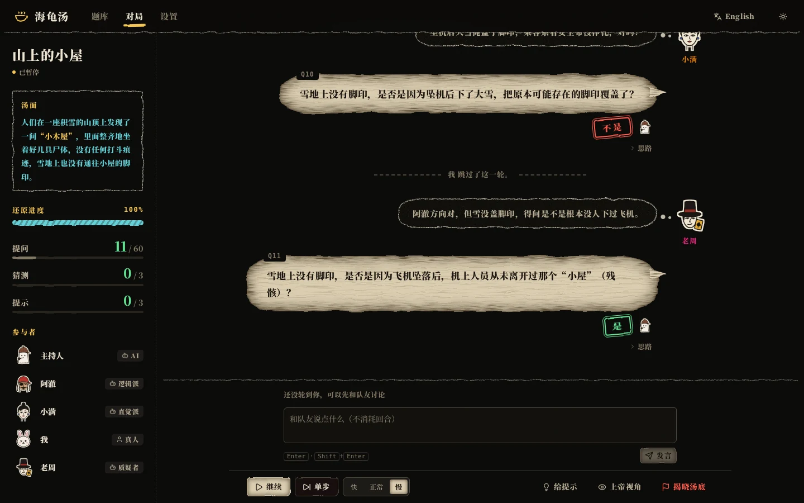
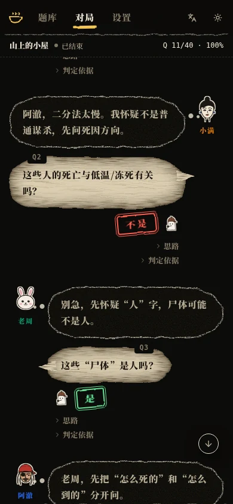

<div align="center">

# 海龟汤 · Turtle Soup

**人类出题，AI 主持，AI 推理。** 一个完整的海龟汤（情境推理猜谜）游戏：你写下汤面和汤底，AI 主持人掌握真相，若干性格各异的 AI 玩家通过是非题一步步还原故事。你可以观战、随时干预，也可以亲自下场当玩家或主持人。

[English](README.en.md) · 基于 DeepSeek V4.1 Flash · FastAPI + React

[](https://github.com/JQW2006/turtle-soup/actions/workflows/ci.yml)
[](LICENSE)


</div>



> 黑底手绘绘本风格：每位玩家有自己的手绘角色头像，提问写在羊皮纸对话气泡里，主持人用印章盖下“是 / 不是”，汤面写在粉笔画框里。

## 功能

**出题**
- 汤面、汤底、主持人须知（统一口径、歧义说明）、汤色（清汤 / 红汤）、类型（本格 / 变格）、难度、标签
- **AI 拆解要点**：把汤底拆成 3–6 条可被是非题验证的关键要点（区分核心 / 次要，带权重），用于判定还原度和进度；也可以手动编辑
- **AI 质量检查**：检查泄底、线索不足、逻辑矛盾、多解、冷门知识依赖、表述歧义，并建议难度和分类
- 内置 22 道经典题（中文 14 道，英文 8 道），支持 JSON 导入 / 导出；查看已有题目时默认隐藏汤底，防止剧透

**对局**
- 1–4 名玩家轮流行动，每位 AI 玩家可选推理风格（逻辑派 / 直觉派 / 细节控 / 质疑者 / 自定义）和思考强度
- 主持人只回答 **是 / 不是 / 无关 / 是也不是**；开放式问题会被要求“换个问法”且不计次数
- 主持人会标记 **关键问题**，并可附带不泄底的元信息（方向对了 / 前提有误 / 已经问过了 / 不必纠结这个）
- 玩家之间可以 **讨论**（不消耗提问次数），分享假设、回应队友
- 玩家确信时可以提交完整 **还原**；主持人对照要点逐条评判，给出不泄底的反馈
- **提示机制**：玩家可申请提示；连续 N 问没有新进展时主持人自动给提示；提示逐步具体，但不直接给答案
- 可配置提问上限、猜测次数、提示次数，提问用完后进入 **最终作答** 轮
- 左侧实时显示汤面、计数、**还原进度**、谁正在思考；每条发言下可展开查看 AI 的推理思路

**人类的位置**
- **观战**：暂停 / 继续 / 单步（空格、`S` 键）、三档速度、插入提示（自己写或让 AI 写）、**修正主持人的错误判定**、直接揭晓汤底
- **上帝视角**：查看汤底、各要点的确认进度、主持人的判定依据（你作为玩家参赛时会先提醒剧透）
- **当玩家**：轮到你时提问 / 提交还原 / 求提示 / 跳过，不在你的回合也可以随时和 AI 队友讨论
- **当主持人**：亲自回答提问、评判还原、给提示；可随时点“AI 参考”看 AI 的判定建议

**复盘**
- 揭晓汤底，给出评级（S / A / B / C / D）和分数明细
- 各要点由谁、在哪一问确认，回答分布、用时、Token 消耗
- 主持人点评：整体评价、关键转折问题（可点击跳转）、最大的弯路、MVP
- 每位玩家的提问数、关键问题数、确认要点数
- 导出 Markdown / JSON，一键“再来一局”（沿用同样的配置）

**其他**
- 对局全过程持久化到 SQLite，服务器重启后对局自动暂停，可继续
- SSE 实时推送，多个浏览器标签同时观看同一局
- 手绘绘本风格界面：手绘角色头像、羊皮纸对话气泡、判定印章、粉笔画框、胶片颗粒；暗夜（默认）/ 旧纸两套主题
- 中英双语界面，适配手机；字体（思源宋体）随前端一起打包，不依赖外部字体服务
- 可选访问口令，方便部署到公网

<table>
<tr>
<td width="50%"><p align="center">题库：每道题是一张羊皮纸卷宗</p></td>
<td width="50%"><p align="center">复盘：评级印章、要点还原、主持人点评</p></td>
</tr>
<tr>
<td><p align="center">开局：为每位 AI 玩家选推理风格</p></td>
<td><p align="center">旧纸主题 + 上帝视角</p></td>
</tr>
</table>

<p align="center"></p>

## 快速开始

需要一个 [DeepSeek API Key](https://platform.deepseek.com)。

### Docker

```bash
cp .env.example .env        # 填入 DEEPSEEK_API_KEY
docker compose up -d --build
```

打开 <http://localhost:8000>。数据保存在 `./data`。

### 本地运行

需要 Python 3.11+ 和 Node.js 20+。

```bash
cp .env.example .env        # 填入 DEEPSEEK_API_KEY
make install                # 安装后端与前端依赖
make dev                    # 后端 :8000 + 前端 :5173（热更新）
```

开发时打开 <http://localhost:5173>。也可以构建后由后端一并提供页面：

```bash
make start                  # 构建前端，在 :8000 同时提供页面和 API
```

不使用 `make` 时：

```bash
pip install -r backend/requirements.txt
cd frontend && npm ci && npm run build && cd ..
cd backend && uvicorn app.main:app --port 8000
```

### 部署到自己的服务器（无需 root）

```bash
cp .env.example .env              # 填入 Key；公开访问时设置 SETTINGS_LOCKED=true 或 APP_ACCESS_TOKEN
make build
HOST=0.0.0.0 PORT=8000 deploy/serve.sh      # 前台运行，进程崩溃后自动重启
```

后台常驻并开机自启：

```bash
tmux new -d -s soup "deploy/serve.sh"
(crontab -l 2>/dev/null; echo "@reboot tmux new -d -s soup $(pwd)/deploy/serve.sh") | crontab -
```

API Key 也可以不写在 `.env` 里，启动后在 **设置** 页填写（保存在本地数据库，优先级高于 `.env`），并可一键测试连接。

## 配置

| 变量 | 默认值 | 说明 |
| --- | --- | --- |
| `DEEPSEEK_API_KEY` | — | DeepSeek API Key |
| `DEEPSEEK_BASE_URL` | `https://api.deepseek.com` | OpenAI 兼容的接口地址 |
| `DEEPSEEK_MODEL` | `deepseek-flash` | 模型名（`deepseek-flash` 即 DeepSeek-V4.1-Flash） |
| `APP_ACCESS_TOKEN` | 空 | 设置后所有 API 请求都需要该口令，部署到公网时建议设置 |
| `SETTINGS_LOCKED` | `false` | 设为 `true` 时设置页只读。公开部署且不设口令时**务必开启**，否则访客可以替换 Key，或把 Base URL 指向自己的服务器来窃取你的 Key |
| `DATABASE_URL` | `sqlite:///./data/soup.db` | 数据库位置 |
| `CORS_ORIGINS` | `http://localhost:5173,…` | 允许跨域的前端地址 |

### 思考强度怎么选

每位 AI 玩家和主持人都可以单独设置：

| 档位 | 说明 |
| --- | --- |
| 不思考 | 关闭隐藏思维链，玩家仍会在回复里写出简短推理。单次约 1–2 秒，**玩家默认** |
| 低 / 高 / 最高 | 开启推理，越高越慎重也越慢（玩家用“低”约 10–20 秒一步） |

主持人默认“高”：判定的准确性最重要，且主持人的输出很短，通常 2–4 秒。

## 游戏规则与计分

一局的流程：主持人念汤面并宣布规则 → 玩家按顺序轮流行动（提问 / 还原 / 求提示，可附带一句讨论）→ 主持人判定 → 直到有人还原成功、猜测次数用尽、最终作答结束，或观众揭晓汤底 → 复盘。

- **判定**：是、不是、无关（不影响真相的细节）、是也不是（部分正确或前提有偏差）、请换个问法（非是非题，不计次数）
- **要点**：每道题有若干关键要点。玩家的提问实质说中某个要点并得到肯定时，该要点被确认，进度条随之前进
- **还原成功**：提交的还原覆盖了全部核心要点、整体逻辑与汤底一致
- **计分**（满分 100）：
  - 成功：`100 − 30 × 提问数/提问上限 − 8 × 提示数 − 6 × 猜错次数`，最低 40
  - 未成功：`60 × 还原度 − 5 × 提示数`
  - 评级：S ≥ 90，A ≥ 75，B ≥ 60，C ≥ 40，其余为 D

AI 玩家的提示词中明确了这套计分方式：它们会尽量少问，但不会凭空乱猜；也被要求像真人一样推理，即使觉得题目眼熟也不能凭记忆作答。

## 出一道好汤

- 汤面要有 **反常之处**，让人想追问“为什么”；不要直接写出关键信息
- 汤底要能完整解释汤面的每一个细节，最好只有一种合理解释
- 关键要点只写汤面 **没有** 给出、需要推理才能得到的信息
- 容易引起分歧的问题写进“主持人须知”，比如“问到人物姓名一律回答无关”
- 写完点一下“质量检查”

## 项目结构

```
backend/
  app/
    engine.py      对局引擎：回合循环、主持人判定、提示、最终作答、结算；每局一个 asyncio 任务
    prompts.py     主持人 / 玩家 / 出题工具的提示词（中英文）
    scoring.py     计分与复盘统计
    llm.py         DeepSeek（OpenAI 兼容）调用、JSON 解析、重试
    routers/       puzzles / games / settings 接口
    data/          内置题库
  scripts/gen_seed.py   内置题库源文件
  tests/           pytest（使用脚本化的假 LLM，不消耗 API）
frontend/
  src/pages/       题库、出题、开局、对局房间、对局记录、设置
  src/components/  时间线、人类操作面板、复盘、通用组件
                   ink.tsx：手绘风格的 SVG 滤镜与角色头像
  src/lib/         API 客户端、SSE 同步、i18n、主题
```

对局中发生的每件事（开场、提问、判定、讨论、猜测、提示、系统消息、揭晓）都是一条持久化的事件，通过 SSE 推送给所有观看的页面；主持人和玩家的提示词都从同一份公开记录构建，所以人工修正某个判定后，后续的 AI 推理会立即基于修正后的结果。

## 接口概览

| 方法 | 路径 | 说明 |
| --- | --- | --- |
| `GET/POST` | `/api/puzzles` | 题目列表（支持 `q`、`language`、`color`、`genre`、`source`）/ 新建 |
| `GET/PUT/DELETE` | `/api/puzzles/{id}` | 题目详情 / 修改 / 删除 |
| `POST` | `/api/puzzles/analyze/points` | AI 拆解要点 |
| `POST` | `/api/puzzles/analyze/review` | AI 质量检查 |
| `GET/POST` | `/api/puzzles/export`、`/import` | 导出 / 导入 JSON |
| `POST` | `/api/games` | 开局 |
| `GET` | `/api/games/{id}/stream` | SSE：先推送完整快照，再推送增量 |
| `POST` | `/api/games/{id}/control` | `pause` / `resume` / `step` / `end` |
| `POST` | `/api/games/{id}/player` | 人类玩家：`ask` / `guess` / `say` / `hint` / `pass` |
| `POST` | `/api/games/{id}/host/answer`、`/judge`、`/hint` | 人类主持人操作 |
| `POST` | `/api/games/{id}/events/{seq}/override` | 修正判定 |
| `GET` | `/api/games/{id}/export?format=md\|json` | 导出对局 |

启动后访问 <http://localhost:8000/docs> 查看完整的交互式文档。

## 开发

```bash
make test     # 后端测试
make lint     # ruff + oxlint + TypeScript 类型检查
```

修改内置题库：编辑 `backend/scripts/gen_seed.py` 后运行 `python backend/scripts/gen_seed.py`。内置题只在数据库首次初始化时导入。

## 参与贡献

欢迎提 Issue 和 PR，详见 [CONTRIBUTING.md](CONTRIBUTING.md)。

## 许可

[MIT](LICENSE)
